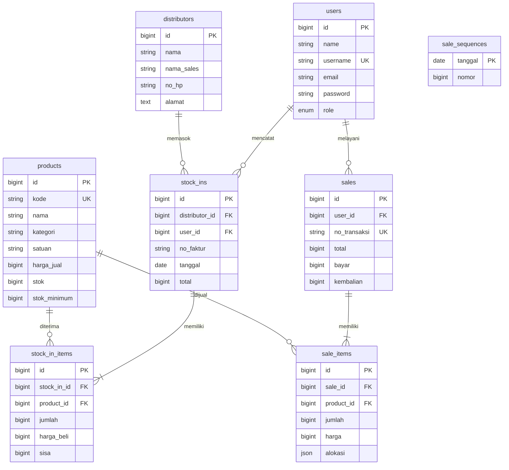

# Bina Mandiri PS

Sistem Informasi Pengelolaan Stok dan Analisis Penjualan untuk toko Bina Mandiri PS (Poultry Shop). Laravel 12, PHP 8.2+, Blade, MySQL, serta PHPUnit dengan SQLite. CSS dan JavaScript disajikan langsung dari `public/`; **tidak memerlukan npm, Vite, React, atau Vue**.

## Instalasi

Kebutuhan: PHP 8.2 atau lebih baru, Composer 2, MySQL 8+, ekstensi PHP `pdo_mysql`, `pdo_sqlite`, `mbstring`, `openssl`, `fileinfo`, `dom`, `xml`, `ctype`, dan `tokenizer`. Ekstensi `zip` mempermudah pengunduhan dependensi Composer.

1. Buka terminal di folder proyek, kemudian jalankan:

   ```powershell
   composer install
   Copy-Item .env.example .env
   php artisan key:generate
   ```

2. Aktifkan MySQL melalui Laragon/XAMPP. Buat database **kosong** melalui MySQL atau phpMyAdmin:

   ```sql
   CREATE DATABASE bina_mandiri_ps CHARACTER SET utf8mb4 COLLATE utf8mb4_unicode_ci;
   ```

3. Sesuaikan `.env` dengan database Anda:

   ```dotenv
   APP_NAME="Bina Mandiri PS"
   APP_LOCALE=id
   DB_CONNECTION=mysql
   DB_HOST=127.0.0.1
   DB_PORT=3306
   DB_DATABASE=bina_mandiri_ps
   DB_USERNAME=root
   DB_PASSWORD=
   SESSION_DRIVER=file
   CACHE_STORE=file
   ```

4. Jalankan migrasi dan seeder akun, kemudian server:

   ```powershell
   php artisan migrate --seed
   php artisan serve --host=127.0.0.1 --port=8000
   ```

5. Buka **http://127.0.0.1:8000**. Pada Windows, `start.bat` dapat dipakai untuk menjalankan server setelah instalasi. Skrip mendeteksi PHP di PATH, Laragon yang tersedia pada komputer ini, atau XAMPP.

Di Linux/macOS, gunakan `cp .env.example .env` untuk langkah penyalinan. Document root pada Apache/Nginx harus menunjuk ke folder `public/`.

Jika PHP/Composer Laragon belum ada di PATH pada komputer ini, gunakan:

```powershell
$mandiriPhp = 'C:\laragon\bin\php\php-8.3.16-Win32-vs16-x64\php.exe'
& $mandiriPhp -d extension=zip 'C:\laragon\bin\composer\composer.phar' install
& $mandiriPhp artisan key:generate
& $mandiriPhp artisan migrate --seed
& $mandiriPhp artisan test
```

Jika ekstensi ZIP sudah aktif di `php.ini`, hilangkan `-d extension=zip`. Jangan menyalin `.env` dari proyek lama yang memakai skema berbeda; aplikasi ini memakai database baru. Proyek ini memakai kerangka Laravel dari arsip lokal `PSI_kelompok2-feat-bina-mandiri-role-system (2).zip`, dengan skema dan fitur yang disesuaikan terhadap permintaan. PDF laporan proyek dipakai sebagai konteks usaha; hak akses mengikuti permintaan pada file teks.

## Akun login

| Peran | Nama pengguna | Kata sandi awal | Halaman setelah login |
| --- | --- | --- | --- |
| Owner | `owner` | `owner123` | Dashboard |
| Kasir | `kasir` | `kasir123` | Kasir |

Seeder utama hanya membuat dua akun tersebut, tanpa data produk atau transaksi. Menjalankan ulang seeder tidak mereset kata sandi akun yang sudah ada. Ganti kata sandi awal sebelum penggunaan sungguhan melalui konsol administrasi, misalnya `php artisan tinker`, kemudian `App\Models\User::where('username', 'owner')->firstOrFail()->update(['password' => 'kata-sandi-baru']);`. Password otomatis di-hash oleh model.

## Data contoh opsional

```powershell
php artisan db:seed --class=DemoSeeder
```

Jalankan hanya pada database latihan. DemoSeeder membuat 9 produk, 1 distributor, 2 faktur dan 41 penjualan untuk contoh grafik serta status aman/menipis/habis. Semua stok demo juga diproses melalui `StockService`. Demo tidak berjalan otomatis dan tidak ditambahkan ulang selama faktur `DEMO-AWAL` masih ada.

## Fitur dan hak akses

| Fitur | Owner | Kasir |
| --- | --- | --- |
| Dashboard dan analisis penjualan | Ya | Tidak |
| CRUD produk dan distributor | Ya | Tidak |
| Pencatatan dan penghapusan faktur barang masuk | Ya | Tidak |
| Keranjang dan pembayaran penjualan | Tidak | Ya |
| Peringatan stok, hanya lihat | Ya | Ya |
| Cetak struk transaksi | Ya | Transaksi sendiri |
| Pembatalan transaksi penjualan | Ya | Tidak |
| Laporan dan ekspor CSV | Ya | Tidak |

Hak akses diperiksa oleh middleware `auth` dan `role` serta FormRequest di server. Tamu diarahkan ke login, sedangkan akses lintas peran menghasilkan HTTP 403. Percobaan login dibatasi 5 kali per menit. Menu Kasir hanya berisi Kasir dan Peringatan stok.

- **Produk:** CRUD, pencarian nama/kode/kategori, kode unik, harga dan stok minimum. Produk baru dimulai dengan stok nol. Stok tidak dapat diedit melalui formulir master; gunakan barang masuk. Produk yang memiliki riwayat tidak dapat dihapus.
- **Distributor:** CRUD, kontak sales, nomor HP, alamat, dan jumlah faktur. Distributor yang mempunyai faktur tidak dapat dihapus.
- **Barang masuk:** distributor, nomor faktur unik per distributor, tanggal faktur, beberapa baris produk, jumlah, harga beli dan total. Produk yang sama tidak boleh muncul dua kali dalam satu faktur; tambahkan jumlah pada satu baris.
- **Kasir:** cari produk, tambah/hapus keranjang, ubah jumlah, total otomatis, uang diterima dan kembalian. Produk habis tidak dapat dipilih. Server menghitung ulang harga dan total; nilai harga dari peramban diabaikan. Uang kurang atau stok kurang ditolak tanpa menyimpan transaksi.
- **Struk:** nama toko, nomor transaksi, waktu, kasir, rincian produk, total, tunai dan kembalian. Pilih 58 atau 80 mm, lalu Cetak struk. Atur ukuran kertas yang sama pada driver printer, skala 100%, margin minimal, serta nonaktifkan header/footer peramban. Lebar isi 50/72 mm memberi ruang untuk area cetak printer. Pencetakan fisik bergantung pada printer dan drivernya.
- **Dashboard:** omzet dan jumlah transaksi hari ini, produk perlu restock, total produk, grafik harian 30 hari, grafik bulanan 12 bulan, lima produk terlaris 30 hari, serta daftar pemesanan ulang. Grafik dibuat dengan HTML/CSS tanpa CDN, dengan rincian angka yang dapat dibuka. Periode tanpa penjualan bernilai nol.
- **Laporan:** filter tanggal inklusif, tabel transaksi beserta barang, ringkasan omzet, produk terlaris dan pembelian distributor. Penjualan disaring berdasarkan waktu transaksi; pembelian berdasarkan tanggal faktur. Tombol CSV penjualan dan CSV pembelian memakai filter yang sama. File UTF-8 dengan BOM mendukung nama berbahasa Indonesia; teks berawalan formula dinetralkan untuk spreadsheet.
- **Tampilan:** bahasa Indonesia, rupiah tanpa desimal (`Rp1.234.567`), waktu Asia/Jakarta, responsif, dan dark mode mengikuti pengaturan sistem/peramban.

## Konsistensi stok dan nomor transaksi

Seluruh perubahan stok tersimpan hanya dilakukan di `app/Services/StockService.php`. Setiap penerimaan, penjualan, pembatalan dan penghapusan faktur memakai `DB::transaction`. Produk dikunci dengan `lockForUpdate` dalam urutan ID yang konsisten; stok kembali diperiksa setelah lock diperoleh.

Stok dan jumlah merupakan bilangan bulat, termasuk untuk kg dan gram. Contohnya, barang yang dijual per gram menggunakan produk dengan satuan `gram` dan harga per gram. Belum ada konversi satuan otomatis. Untuk mendukung pecahan di masa depan, migrasikan semua kolom `stok`, `stok_minimum`, `jumlah`, `sisa`, perhitungan alokasi, validasi dan keranjang secara bersamaan ke decimal; jangan hanya mengubah input HTML.

Nomor transaksi menggunakan `TRX-YYYYMMDD-0001`. Tabel internal `sale_sequences` menyimpan dan mengunci urutan setiap hari, sehingga transaksi bersamaan memperoleh nomor berbeda. Nomor transaksi yang telah dibatalkan tidak dipakai ulang.

Aturan sisa faktur memakai FIFO menurut urutan pencatatan barang masuk (`stock_in_items.id`). Kolom `sisa` menyimpan jumlah barang faktur yang belum terjual. `sale_items.alokasi` menyimpan asal barang sehingga pembatalan dapat mengembalikan stok ke faktur yang tepat. Faktur yang terpakai ditolak penghapusannya meskipun total stok sudah bertambah dari faktur baru. Setelah seluruh penjualan terkait dibatalkan, faktur dapat dihapus dan stoknya dikurangi kembali.

Pembatalan menghapus transaksi dan itemnya dalam satu transaction, mengembalikan stok serta sisa faktur, dan mengeluarkan transaksi dari omzet, produk terlaris, serta CSV. Ini mengikuti skema permintaan yang tidak memiliki kolom status pembatalan. UI meminta konfirmasi sebelum tindakan pembatalan/penghapusan.

Foreign key produk, distributor dan pengguna menggunakan `restrictOnDelete`; relasi header ke item memakai `cascadeOnDelete`. Harga jual saat transaksi disimpan di `sale_items.harga`, sehingga perubahan harga katalog tidak mengubah total transaksi lama. Nama produk dan satuan pada riwayat/struk mengikuti master produk saat ini.

## Pengujian

```powershell
php artisan test
```

`phpunit.xml` menggunakan SQLite **in-memory**, terpisah dari MySQL operasional. Tidak diperlukan database pengujian manual. Pengujian mencakup:

- Login, logout, tamu, pembatasan percobaan login, dan HTTP 403 peran.
- CRUD master, kode unik, pencarian, stok master yang tidak dapat dimanipulasi, dan larangan menghapus data yang memiliki riwayat.
- Barang masuk, stok berkurang saat penjualan, harga dihitung server, penolakan stok/uang kurang, bilangan pecahan/negatif/nol, dan duplikasi baris.
- Pengembalian stok saat pembatalan, pembatalan ganda, nomor tidak dipakai ulang, sisa FIFO lintas faktur, larangan menghapus faktur terpakai dan rollback pada kegagalan di tengah transaksi.
- Status aman/menipis/habis pada batas minimum dan nol; struk 58/80 mm.
- Omzet harian/bulanan, pergantian bulan dan akhir bulan, filter rentang tanggal, ekspor penjualan/pembelian, dan dikeluarkannya transaksi batal dari laporan.
- Seeder utama tanpa data demo, DemoSeeder terpisah dan dapat dijalankan ulang, serta rendering halaman dengan data kosong dan terisi.

SQLite memverifikasi alur dan rollback, tetapi tidak menerapkan row locking seperti InnoDB. Pengujian persaingan transaksi perlu MySQL; gunakan database terpisah, jangan database operasional.

Untuk menjalankan skrip persaingan MySQL, buat database kosong `bina_mandiri_ps_verification`, lalu pada terminal PowerShell terpisah:

```powershell
$env:DB_CONNECTION = 'mysql'
$env:DB_DATABASE = 'bina_mandiri_ps_verification'
# Atur DB_HOST, DB_PORT, DB_USERNAME, DB_PASSWORD sesuai server pengujian.
php artisan migrate --seed
php scripts/verify-mysql.php
```

Skrip menolak database yang namanya tidak berakhiran `_verification`. Dua proses PHP mencoba menjual masing-masing 4 unit dari stok 5: satu harus berhasil dan satu harus ditolak, dengan stok akhir 1. Empat proses berikutnya harus menghasilkan empat nomor transaksi unik. Data produk, distributor, faktur dan penjualan uji dibersihkan melalui service setelah selesai. Penghitung nomor harian tetap bertambah.

Hasil validasi akhir: **24 pengujian dengan 208 assertions lulus pada SQLite dan MySQL 8.4**, ditambah dua skenario persaingan transaksi MySQL. Di Edge, **18 pemeriksaan lulus tanpa exception JavaScript**: login dua peran, pembuatan produk/distributor, faktur multibaris, keranjang, pembayaran, struk, pembatalan, tampilan 390px, serta dark mode. Printer thermal fisik belum diuji.

## ERD



Semua tabel bisnis memiliki timestamps. `sale_sequences` adalah tabel internal untuk penomoran harian, tanpa timestamps. Kunci gabungan `(distributor_id, no_faktur)` dan `(stock_in_id, product_id)` juga unik.

## Tahap pengerjaan

Riwayat Git dibagi menjadi empat commit: (1) fondasi, autentikasi dan CRUD master; (2) barang masuk, kasir, struk dan pembatalan; (3) dashboard dan laporan; (4) pengujian lanjutan, data demo, dokumentasi dan perapian. `php artisan test` dijalankan pada setiap tahap.

## Pemecahan masalah

- **Could not find driver:** aktifkan `pdo_mysql`/`pdo_sqlite` pada `php.ini` yang dipakai CLI; periksa dengan `php --ini` dan `php -m`.
- **Connection refused:** aktifkan MySQL, periksa host/port dan kredensial `.env`, lalu jalankan `php artisan config:clear`.
- **Unknown database / tabel tidak ada:** buat database kosong yang benar, kemudian `php artisan migrate --seed`.
- **Halaman lama setelah mengubah konfigurasi:** jalankan `php artisan optimize:clear`.
- **Port 8000 terpakai:** jalankan `php artisan serve --port=8001`, lalu akses port tersebut.
- **HTTP 419:** muat ulang formulir atau masuk kembali; session/cookie browser harus aktif.
- **Git dubious ownership di Windows:** pada mesin ini proses sandbox dan pengguna Windows dapat berbeda. Gunakan opsi per perintah `git -c safe.directory=C:/mandiri status`; tidak perlu mengubah pengaturan Git global.

Untuk penggunaan di server, sesuaikan URL, gunakan HTTPS, set `APP_ENV=production`, `APP_DEBUG=false`, `SESSION_SECURE_COOKIE=true`, dan pastikan `storage/` serta `bootstrap/cache/` dapat ditulis oleh web server.
